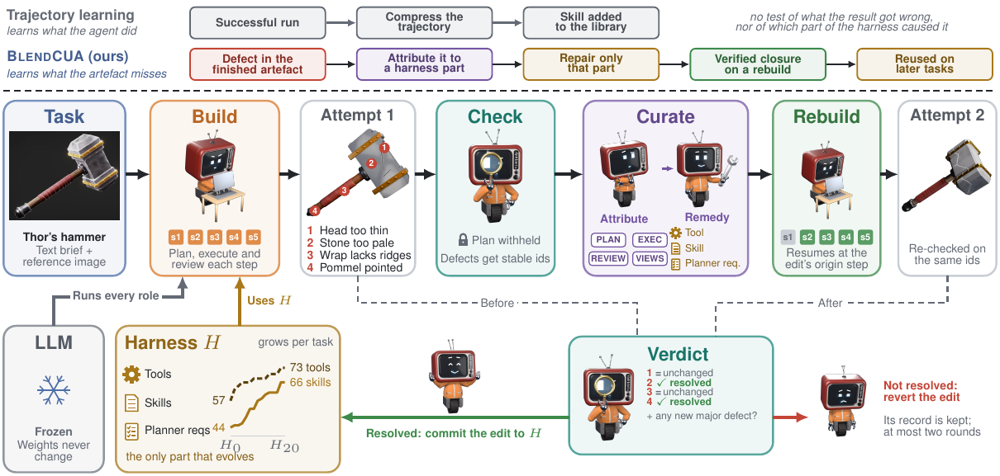
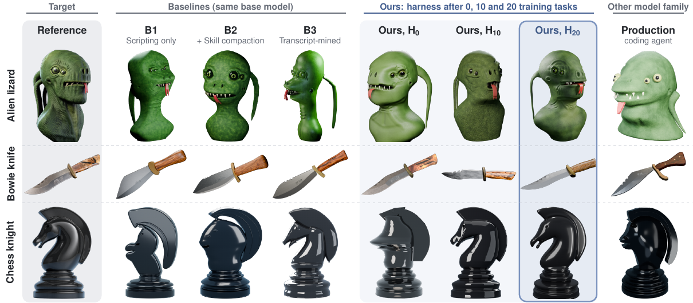
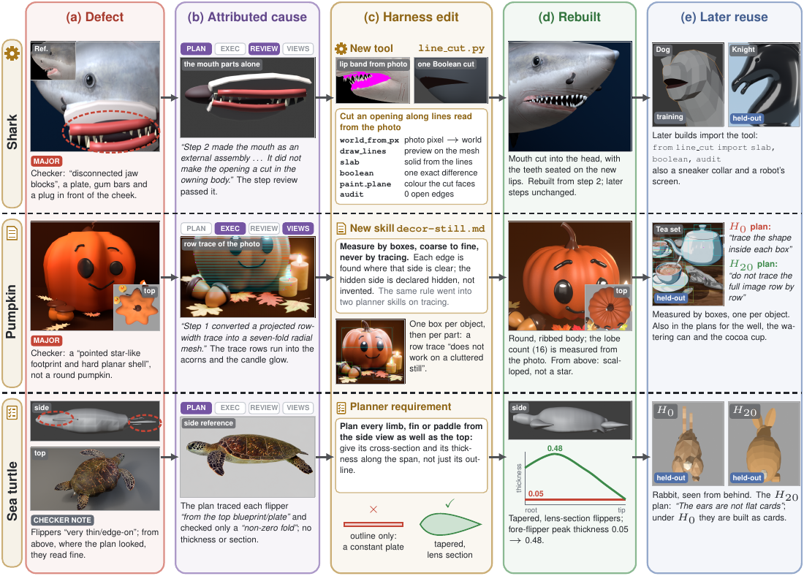
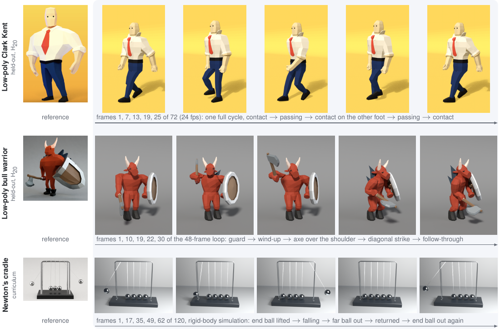

# BlendCUA

**A self-evolving harness for an LLM agent that works in Blender.**



BlendCUA is an LLM agent that builds things in Blender from a short text brief and a reference image. It covers
modelling, materials, physics simulation and animation. The model is frozen. What improves is the **harness**:
the tools the agent can call, the skills that show it procedures, and the requirements its planner must meet.

Self-improving agents usually learn from transcripts. They compress a successful run into a skill, which captures
what the agent *did* but not what its result got *wrong*. BlendCUA learns from the defects in its finished work
instead:

1. **Build.** A planner measures the reference and writes a step-by-step plan. An executor builds it in a live
   Blender, and a reviewer checks every step.
2. **Check.** An independent checker looks at renders of the finished model and lists its defects. It never sees
   the plan, so it judges only the result.
3. **Attribute.** A curator traces each defect to the part of the harness responsible: the *plan*, the
   *execution*, the *review*, or the *generated reference views*. Every claim cites a file and line from the run.
4. **Repair.** The curator edits only that part, with a plan correction, a new or extended skill, or a new tool.
5. **Rebuild and verdict.** The task is rebuilt from the step where the defect started. The checker re-checks the
   same defect IDs. The edit is committed to the harness only if the defect is closed and nothing new broke.
   Otherwise it is reverted.

Over a 20-task curriculum, the harness grew from 57 to 73 tool modules and from 44 to 66 skills.

📄 **Paper:** [`paper/BlendCUA.pdf`](paper/BlendCUA.pdf) (under review; appendices are included after the references)

## Results

The evaluation uses 10 held-out tasks that the curator never sees, with curation switched off. Every row uses the
same frozen model (GPT-5.6-luna) except the last one.

| System | Brief compliance (0–5) ↑ | Form fidelity (0–4) ↑ | Mesh quality (0–100) ↑ | Major defects ↓ | Mean rank ↓ |
|---|:-:|:-:|:-:|:-:|:-:|
| B1: Python-in-Blender tool only | 3.35 | 2.70 | 76.6 | 3.80 | 5.90 |
| B2: + skill compaction (Voyager-style) | 3.30 | 3.00 | 82.0 | 3.90 | 5.20 |
| B3: curation from transcripts | 3.50 | 3.10 | 84.5 | 2.80 | 3.90 |
| **BlendCUA**, hand-built H<sub>0</sub> | 4.10 | 3.50 | 87.4 | 2.90 | 3.10 |
| **BlendCUA**, H<sub>10</sub> (after 10 tasks) | **4.35** | 3.45 | 89.2 | 2.50 | 3.00 |
| **BlendCUA**, H<sub>20</sub> (after 20 tasks) | 4.15 | **3.60** | **92.3** | **2.00** | **2.50** |
| *Claude Sonnet 5 in Claude Code (other model family)* | 3.20 | 2.50 | 79.7 | 3.20 | 4.40 |

B3 is the closest comparison. It is the same agent on the same curriculum, and only the learning signal differs.
Learning from defects beats it on every measure and cuts major defects by 29%. Brief compliance and form fidelity
are judged blind by a model. Mesh quality is computed from the saved scene with no model involved.



## How a defect becomes a harness edit

Each row follows one defect. The checker finds it, the curator attributes it, the harness edit is made, the rebuild
verifies it, and a later task reuses the edit.



## Not only static models

Some tasks ask for rigged animation or physics, and the deliverable is the motion itself.



## Repository layout

| Path | What it is |
|---|---|
| [`blendcua/`](blendcua) | The pipeline, set to the starting harness H<sub>0</sub>, with the 20 training tasks and 10 test tasks |
| [`harnesses/`](harnesses) | The harness the loop grew: H<sub>0</sub>, H<sub>10</sub> and H<sub>20</sub> (skills, tools, prompts). Diff them to see what the agent learned |
| [`baselines/b2_skill_compaction/`](baselines/b2_skill_compaction) | The skill-compaction baseline (B2) |
| [`paper/`](paper) | The paper PDF |

The main pieces of the loop in `blendcua/`:

| Stage | Code |
|---|---|
| Driver: plan, build, check, curate and rebuild every task, resumably | [`run_v2.py`](blendcua/run_v2.py), [`vb/version_b.py`](blendcua/vb/version_b.py) ([algorithm](blendcua/vb/ALGORITHM.md)) |
| Planner: measures the reference, writes the plan | [`planner_agent.py`](blendcua/planner_agent.py) |
| Executor and per-step reviewer | [`blendcua_agent.py`](blendcua/blendcua_agent.py), [`blendcua_core.py`](blendcua/blendcua_core.py), [`mcp_dispatch_server.py`](blendcua/mcp_dispatch_server.py) |
| Checker: finds defects without seeing the plan | [`Checker/checker_agent.py`](blendcua/Checker/checker_agent.py) |
| Curator: attribution and remedy, with code guards on every edit | [`Curator/curator_agent.py`](blendcua/Curator/curator_agent.py), [`Curator/apply_remedy.py`](blendcua/Curator/apply_remedy.py) |
| Rebuild from the blamed step, then the acceptance gate | [`vb/rebuild.py`](blendcua/vb/rebuild.py), [`vb/accept.py`](blendcua/vb/accept.py) |
| Harness store as a git repo, so two workers can merge edits | [`harness.py`](blendcua/harness.py) |
| Blender bridge (a socket server inside a GUI Blender) | [`Tool_scripts/win_blender_server.py`](blendcua/Tool_scripts/win_blender_server.py) |
| The harness itself | [`Skills/`](blendcua/Skills), [`Tool_scripts/Tools_code/`](blendcua/Tool_scripts/Tools_code), [`prompt_files/`](blendcua/prompt_files) |
| Earlier loop that curates from transcripts (B3) | [`feedback_agent.py`](blendcua/feedback_agent.py) |

## Running it

This is research code, shared as it was used for the paper. It ran on Windows machines with GPUs and a GUI
Blender 5.2, and it was not packaged for other setups. Run outputs (`mem/`, `blends/`, `vb/state/`) are left out
because they total several GB. Roughly:

```powershell
# Python 3.12; Blender 5.2 in its default install folder
cd blendcua
pip install -r requirements.txt
# Pillow for Blender's own Python (the tools import it inside Blender):
& "<blender>\5.2\python\bin\python.exe" -m pip install --target=Tool_scripts/Tools_code/_vendor Pillow
# API keys go in a file OUTSIDE the repo (see blendcua_core.load_api_keys)

python Tool_scripts/win_start_blender.py       # GUI Blender with the bridge on port 6666
python run_v2.py --parallel 2                  # grow the harness over tasks/train
python run_v2.py --split test --skip-vb --retry-budget 0 --parallel 2   # test pass, harness frozen
```

Models for every role are set in [`blendcua/models.py`](blendcua/models.py). The internal notes in
[`blendcua/README.md`](blendcua/README.md) and [`blendcua/Potential_issues.md`](blendcua/Potential_issues.md) describe
the loop in detail, along with every problem met while running it.
