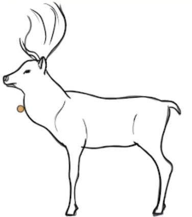

# Low poly is one mesh, extruded and fitted

A low-poly brief is not asking for a coarse replica. It is asking for a different
**construction**: the main mass of the subject is one continuous surface, extruded
and fitted to a traced outline, and the facets you can count are the point. Plan
the construction first and the polygon count takes care of itself; plan the
anatomy first and you get a kit of small parts that is low-poly per part and
elaborate overall.

## 1. The goods are one mesh

Decide, in the plan, what the **main mass** of the subject is — the body, the
torso, the head-and-neck run, the trunk — and say that it is one mesh: a seed
ring extruded through a chain of stations, each station a cross-section placed
where the outline changes width.

Whether a limb comes out of that mesh is a judgement about the subject, not a
rule:

- **It flows out of the mass -> extrude it from the mass.** A deer's legs are
  continuous with the body; you select the faces on the underside of the body and
  extrude *those* down into the leg. Building the leg as a separate tube and
  butting it against the flank puts a seam exactly where the animal has none.
- **It is small, thin, or a different kind of thing -> it can be its own object.**
  A duck's legs are twigs under a body, a wing is a folded plate against a flank,
  an eye is a bead. Forcing those out of the body chain buys nothing and costs you
  loops in the body where you wanted them for shape.

The test is not "how many objects are there". It is: **can a reviewer point at a
seam the subject does not have?** If yes, that part should have been extruded from
the mass it sits on.

## 2. Plates first, then a blueprint — not a silhouette

When the reference is a single view — a 3/4 photograph, a posed animal — there is
nothing to trace. Put the plate work in the plan as its own numbered step, before
any geometry:

1. Synthesise clean **side and front** orthographic views with `gpt-image-2`.
   `Gpt_images/prompting-reference-plates.md` covers how to prompt them and how they fail; the
   short version is that the plate you make is the plate you measure from, so
   verify it before you build on it.
2. Reduce each plate to a **blueprint**: a clean outer contour plus the few
   interior construction lines — the shoulder, the haunch, the jaw, the chest
   break. That is what goes in the viewport as the tracing backdrop.

**A blueprint is not a silhouette.** A silhouette is the filled solid shape; it
answers "where is the outline", and it is the right tool for a mask-IoU check
after the fact. A blueprint carries the *interior* lines, and those are what tell
you where to put a loop. Plan for a blueprint when the job is tracing, a
silhouette when the job is verifying.

### What the two look like

Both plates sit in `low-poly-one-mesh/` beside this file.

`deer-blueprint-line-art.png` — the blueprint. Outer contour, plus the interior
lines that matter: the cheek, the chest, the shoulder, the haunch, the tail root.
Every one of those is a place a loop wants to go. A filled silhouette of the same
deer would have thrown all of them away.

`deer-one-mesh-traced-over-blueprint.png` — the blueprint loaded as the viewport
backdrop with the mesh traced over it. Read the wireframe: it is **one** tube
running muzzle -> head -> neck -> shoulder -> ribcage -> haunch -> tail, with the
loops landing on the blueprint's interior lines, and the foreleg extruded straight
down out of the body's underside faces — no seam at the shoulder, because the deer
has none. This is the whole technique in one picture.

## 3. Name the loops, and the poly budget is a number

The plan's deliverable for the main mesh is a **station table**, not a paragraph:
each cross-section named, with its position on the plate and its width. Then "low
poly" stops being an adjective the reviewer has to interpret and becomes a count it
can check — roughly 10-14 stations for a body run, 4-5 per limb, one ring size for
the whole model.

## 4. Features are cut in, never stuck on

Eyes, nostrils, sockets, mouths and vents are **depressions or Booleans in the
owning surface**. The moment a rim, bar, ring or plate has to be moved *forward* so
that the face stops occluding it, the construction has already failed — the feature
is sitting on the model instead of being part of it.

## The duck did this

`plans/Duck/Duck_plan.md` is the exemplar. The whole bird's mass is **one 12-sided
tube**: a seed ring in the middle of the body, extruded forward through breast,
neck and head, and backward to the tail — sixteen stations, radii falling 88 -> 30 mm
forward and 88 -> 8 mm back. The bill is four more stations **extruded off the head**
and then flattened, because a bill is the front of a duck. The wing, the legs and
the eyes are separate — a flat plate on each flank, a mirrored leg chain stopping at
the ankle, two raycast beads — because they are appendages, not the bird. Around 450
verts, twelve-sided rings, flat shading, eight flat colours.

Note also what that plan pins down before any of it: the traced points are
screen-space `(x_norm, y_norm)` against **one** ortho view, so the view is
re-established at the top of every action. If you plan a traced build, the view is
part of the coordinate system and belongs in the plan.

## The skull did not

`04_skull_run_001` was given "model a low poly skull... make the overall shape
first, and then make circular holes for eyes", and the plan wrote an anatomy kit
instead: a three-part blockout (`Cranium` / `Midface` / `Mandible`) with the brow
and orbit rims specified as *"faceted struts around the front"* and a *"solid rim
around the future aperture and a central septum"* — 61 mesh objects in 2,736 verts,
low-poly per part and elaborate as a whole.

Then the rims sat behind the face, so the executor moved them to `Y=1.03-1.12` to
sit *in front of* the `Y~0.98` facial cap — goggles instead of sockets. That is §4
failing, and it failed because §1 had already failed: there was never one mass to
cut a socket into.

See also `structural-ownership-before-presentation.md` — that skill is about
finishing a multi-part model's attachments in the step that owns them; this one is
about not having those parts in the first place.
