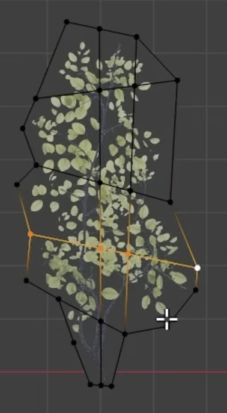

# Flat objects: the image is the shape, the mesh is the form

Some subjects are thin. A leaf, a petal, a feather, a flag, a sheet of paper, a
butterfly wing — for all of these, the interesting outline is *already* in the
reference, and it is far more intricate than anything you would model. Trying to
build that outline out of polygons is the single most reliable way to lose a
low-poly build: you get straight-edged approximations of curves, blocky holes
where the reference has slots, and a per-leaf vertex budget that buys you nothing.

**Split the job in two.** The **image** carries the silhouette, the openings, the
veins, the colour and the fine detail. The **mesh** carries only the form — the
fold, the droop, the curl, the twist. Neither one tries to do the other's job.

## Two ways, and how to choose

**A — model or trace it.** Take a clean plan view and build the blade as geometry,
outline and all. Choose this only when the outline itself must *be* geometry: the
object is a hero at close range, it is seen edge-on where a card would vanish, it
has to deform under a simulation, or its thickness reads in the shot.

**B — alpha card over a rough cage.** The default for foliage and anything that
appears many times. Choose this whenever the object is thin, repeated, and seen
at middle distance — which is nearly every leaf on nearly every plant.

Say which one you are using in the plan, and say why in one line. The failure is
almost always silently choosing A for something that wanted B.

## Method B, in the order the plan should state it

1. **Get the plate and cut it to alpha.** Start from a face-on / top view of the
   single object and produce an image in which **only the object is opaque** and
   every other pixel is fully transparent. `Gpt_images/prompting-reference-plates.md` covers
   getting the plate; the thing to verify here is the alpha itself — a halo, a
   soft vignette or a leftover background fringe will show up as a grey skirt
   around every instance in the render.
2. **Build a rough cage over it.** A coarse polygon that roughly follows the
   object's extent, plus a handful of interior vertices. **This is not a trace.**
   It does not need to follow the lobes or go around the holes — the alpha does
   that. Twenty to forty vertices is plenty.
3. **Map the alpha image onto the cage.** From here the silhouette, the
   fenestrations, the veins and the colour are the texture's job. Nothing about
   the object's *shape* is geometry any more.
4. **Deform the cage to give it form.** This is the whole point and the step that
   gets skipped. Pull the interior vertices down to dip the centre, lift the
   margins, bend along the midrib, curl the tip, twist toward the stem. A card
   that is left flat is worse than a modelled leaf, because it is obviously a
   sticker.
5. **Vary per instance.** Because the form lives in a dozen movable vertices, each
   copy can be genuinely different: a different dip, a different curl, one lobe
   pulled longer, the whole blade scaled, a partial scale on one side. State in
   the plan **how many distinct deformations** the canopy needs — that is a number
   the reviewer can count, unlike "vary the leaves".

`leaf-alpha-card-over-rough-cage.png` — the technique. The foliage sprig is an
alpha-cut image; the black wireframe is the rough cage carrying it, hugging the
extent only, with interior vertices to grab. The orange vertices are a selection
mid-edit — that is step 4 happening. Note that the cage does not follow a single
leaflet and does not go around a single gap, and does not need to.

## Why this is the right default for thin things

A leaf is thin, so a card is not a cheat, it is an honest model of the object. The
detail you would spend a thousand vertices approximating is already in the
photograph at full fidelity. And because the form is now a handful of draggable
vertices rather than a baked outline, variation across a canopy is nearly free —
which is the thing that makes a plant read as grown rather than assembled.

## What the monstera did instead

`03_monstera_pot_run_001` had the plate — `leaf_gpt_image2_cutout.png`, a decent
face-on leaf with the lobes, slots and veins all present — and used it as "a visual
isolate" only. Step 3's `01_leaf_asset.py` then built the blade as geometry:
piecewise-linear outline arrays, a 128×128 regular grid, twelve polyline slit
corridors, eight repeated ellipses and twelve independent tube veins per leaf. The
checker measured the result at leaf-mask **IoU 0.236** against the reference, with
"straight strip lattice, jagged polygonal margins, non-organic fenestrations" and
132 separate vein rods sitting across and beyond the blades.

Then `03_duplicate_leaf_canopy.py` copied that master ten times changing only
transforms, so every leaf was flat and identical and the canopy measured
**side/front width 0.3895** — a flat fan facing the camera.

Every one of those failures is a step-4-and-5 failure. The shape was fought for in
geometry, so there was no budget left for form, and no cage to vary.

## The plan's deliverable

For any flat object, the plan must name: which method (A or B, with the one-line
reason), the plate and how its alpha was verified, the cage vertex count, the list
of deformations that give form, and the number of distinct variants required.
"Vary the leaves" is not a deliverable; "eight cage variants, each with a
centre-dip and tip-curl, midrib bend between 5 and 25 degrees" is.

See also `low-poly-one-mesh.md`, which is the complementary case: solid masses get
one extruded mesh, thin objects get a textured cage. Getting these two the wrong
way round — extruding a leaf, carding a skull — is the mistake both skills exist
to prevent.

## When Solid inspection makes the opening physical

The alpha-card default does not apply when a broad thin part will be inspected
in Solid shading, when edge-on thickness must read, or when its openings must
survive as geometry rather than as transparency. In that case plan a folded,
fenestrated lamina and call the generic `fenestrated_lamina` tool. Supply
caller-owned outer and opening contours, a fold/midrib field, a persistent
attachment anchor, and per-instance profile parameters. The image remains a
colour/vein source only; it may not be the sole silhouette carrier.

Require separate broad and turned profile families, real cut-through openings,
and an isolated Solid proof of the master before instancing. An evaluated
non-rectangular boundary and measured fold depth are construction deliverables,
not presentation effects. Reach for `Tool_scripts/Tools_code/fenestrated_lamina.py`
through the `fenestrated_lamina` entry in `Tool_scripts/Tools_ref/INDEX.md`.

Evidence: `blends/03_monstera_pot_run_001/plan/03_monstera_pot_plan.md#step-1`.
