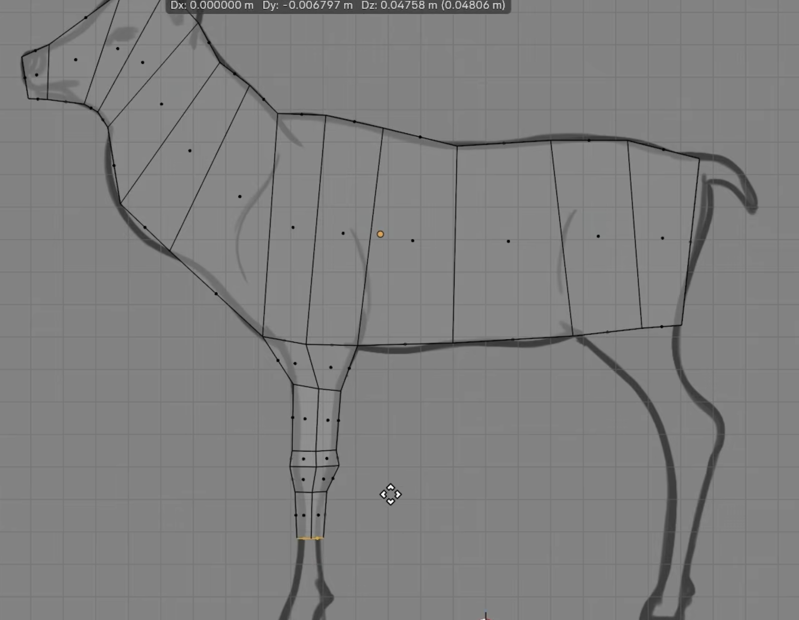

# Low poly: decide the construction per part, then trace where a trace helps

**No method is fully good for all situations.** Tracing, station lofts, blockouts,
extrusion chains, booleans, measured blocks: each fits some subjects and fails others,
and the failure is silent (a row that crosses two parts is still a number). The job of
the plan is to think about *this* subject, decide part by part, measure and script that
decision, use the tools, and work. A plan that applies one recipe to everything has not
thought.

## 1. Three examples of what a trace can and cannot do

- A **tall glass** or a vase: horizontal traces give nearly the whole shape.
- A **human in a T-pose**: horizontal rows give a decent torso and legs, but at the
  shoulder rows they cross the arms too, and a loft through those widths is a poncho with
  cone arms (run_001 of the human, 2026-09-12). The arms need their own direction.
- A **twisted, leaning tree trunk** with thick branch stubs: neither rows nor columns
  describe it. That subject is built from a path and cross-sections, or from a blockout,
  and the picture is used for landmarks and checks only.

Tracing is a way of *reading* the reference. It is not the construction, and it is not
always the right read. Usually a trace helps; sometimes it gives the whole shape.

## 2. The three decisions, written in the plan per part

1. **Which parts get traced at all.** Not the whole object. Name the parts and say for
   each: traced, or built another way (extruded from a reserved root, blocked out from
   measured proportions, a measured block, a boolean cut).
2. **In which direction.** Perpendicular to the part's own axis. A standing figure's
   torso: horizontal. A dog, duck or shark body lies sideways: vertical slices along the
   spine. A slanted or curved part (a neck, a bent leg, a tail): a path with stations
   perpendicular to the path, as the Duck does, not fixed rows. Slant alone does not rule
   a trace out: a shark fin traced with 30-40 dense horizontal lines at a highish poly
   count follows the slant fine. What rules it out is a line that crosses two parts, or
   a part whose axis turns so much that rows stop being cross-sections. And a tilted
   photograph is straightened (a plate) before any trace, or the rows are wrong.
3. **What the trace is for.** Sometimes it gives most of the shape (glass, shark body,
   a fin). Often it gives a good main body and only *points* for the rest (a dog's neck
   and legs, a human's arms). Say which, so the executor knows when to stop tracing.

## 3. When the trace does not give the whole thing

Two routes, and a third if something simpler works or the object is too complex for
either:

- **Reserve a root, then extrude.** Place the body's stations so that one full interval
  sits exactly where a limb leaves the body (the shoulder, the leg root, the neck base).
  The faces of that interval are the root; the limb is extruded out of them and then
  gets its own trace in its own direction, or is placed by eye if it is tilted or
  foreshortened. The body and the limb are one mesh, no seam, and no trace ever crosses
  two parts.
- **Trace for points, build with other tools.** The trace gives landmarks, a centreline,
  widths at a few rows. The construction is a chain extrusion along the centreline, a
  blockout of proportioned volumes, a boolean, whatever fits the part.
- **Something simpler.** A hammer head, a pillar with a rectangular slab, a box: measure
  the blocks (width, height, depth, where each sits) and build them as blocks. Tracing an
  outline there is work that produces nothing a measured block does not.

Do not get stuck on tracing. If the executor is on its fourth residual redo of a part,
the method is wrong for that part, not the numbers.

## 4. The goods are one mesh

The continuous mass of the subject (body, torso, head-and-neck run, trunk) is one mesh.
Whether a limb comes out of that mesh is a judgement about the subject:

- **It flows out of the mass, so extrude it from the mass**, from a reserved root (section 3).
  A deer's legs, a dog's neck and legs, a human's arms and legs are continuous with the
  body; a separate tube butted against the flank puts a seam where the animal has none.
- **It is small, thin, or a different kind of thing, so it can be its own object.** A duck's
  legs are twigs, a wing is a plate on a flank, an eye is a bead, a fin can be a plate.

The test: **can a reviewer point at a seam the subject does not have?** If yes, that part
should have grown from the mass it sits on. Features (eyes, sockets, mouths, vents) are
cut into the owning surface, never stuck on top of it.

## 5. The Duck: the worked example

`plans/Duck/Duck_plan.md`. The body is not read row by row. The plan pins one ortho
view and traces a **centreline** through the bird, from the middle of the body forward
through breast, neck and head and backward to the tail, and at each station reads a
radius by eye against the photograph: some tracing, for the path and the widths, not for
the geometry. It previews the rings as circles (`chain_plan_preview`) and as a profile
with rails (`chain_profile_preview`) before committing, then extrudes one 12-sided seed
ring along the path with `handle.apply_chain`, mitred at every joint, a fillet station
at the hard turn of the shoulder. Only afterwards is the photograph thresholded and the
model's rings measured, both in metres, which caught the one bias the eye cannot see:
the body taper starting too early at every station. The bill is extruded off the head's
own front face, the legs are mirrored chains from faces on the underside, the wing is a
separate plate, the eye a raycast bead. Trace for information, build with the extrusion
tool, check with the outline. A dog is the same problem: a sideways body with a neck
that rises and turns and legs that leave the body at angles, so it wants this method,
not a row table.

## 6. When there are front and side plates

If the subject is a single mass with one axis (a skull, a vase, a head), the traced mass
can be built with `Tool_scripts/Tools_code/plate_loft.py` (`measure_plates`, then a
station table, then `loft_rings`, with `outline_residual` for the check); plan it with
`plan-from-plates`, build with `blueprint-traced-loft`. That tool slices top to bottom
and puts one ring per row, so it is for the one-axis class only; a branched or sideways
subject gets the decisions above first, and the tool at most for the one part it fits.

## 7. Blueprints, not silhouettes, for tracing

When the reference is a single view there is nothing to trace: make front and side
plates with `gpt-image-2` (`Gpt_images/prompting-reference-plates.md`, verify them
first) and reduce each to a blueprint, a contour plus the interior lines (shoulder,
haunch, jaw, chest break) that say where a loop wants to go. A filled silhouette is
for the check afterwards, not the tracing.

The deer: one tube from muzzle through head, neck, shoulder, ribcage and haunch to the
tail with the loops on the blueprint's interior lines, and the foreleg extruded from the
body's underside faces. Note that its body runs sideways: the stations are vertical.

## 8. Station tables and the poly budget

Where a part is traced, the plan's deliverable is a station table (each cross-section
named, its position and width), so "low poly" is a count the reviewer can check:
roughly 10-14 stations for a body run, 4-5 per limb, one ring size for the model.

## 9. The skull did not

`04_skull_run_001` wrote an anatomy kit (`Cranium` / `Midface` / `Mandible`, rims as
struts, 61 objects), then moved the orbit rims in front of the face when they sat
behind it: goggles instead of sockets. Section 4 failed because there was never one
mass to cut a socket into. See `structural-ownership-before-presentation.md`.
